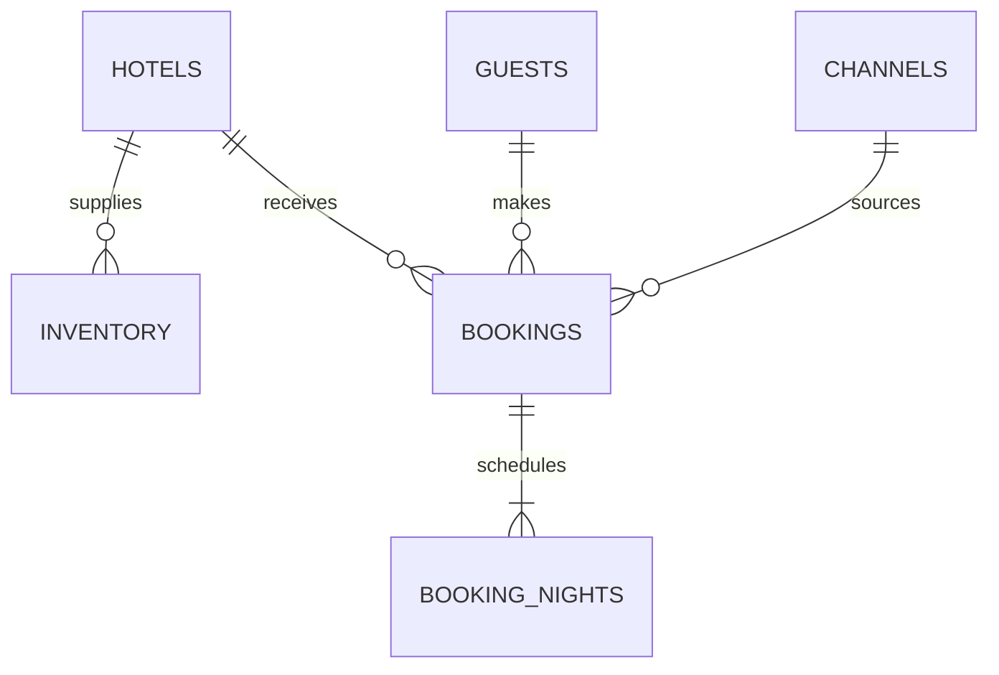

# Hotel Revenue and Cancellation Analytics

**SQL · Python · Synthetic hospitality data · Explanatory analysis**

## Business objective
A fictional three-property hotel group wants to understand occupancy, room pricing and cancellation exposure. The analysis supports revenue managers deciding where to investigate booking policies, distribution channels and availability constraints.

The central question is: **how do booking mix, lead time and available inventory relate to realized room revenue and contribution?** This is a new hospitality project, separate from the earlier fleet, retail and solar examples.

## Executive findings
- Occupancy: **59.5%** across all sellable room-nights.
- Average daily rate (ADR): **NGN 59,497** per occupied room-night.
- Revenue per available room (RevPAR): **NGN 35,388**.
- Cancellation rate: **17.1%** of retained accepted bookings. **OTA** has the highest channel rate at **26.2%**.
- **41.3%** of cancellations occurred within seven days of arrival.
- Realized room revenue: **NGN 3,857,869,600**; room contribution after channel charges and variable service costs: **NGN 2,475,399,173**. This is not net profit.

## Dataset and scope
All data is synthetic, with seed 161803. Stay dates cover 1 January 2024–31 December 2025. Bookings may be made in 2023 for 2024 stays. All outcomes are mature; no future unresolved reservations. One booking reserves one room for 1–6 nights. Rates and costs are fictional NGN excluding taxes, not market benchmarks. No real personal information is included.

| Raw CSV | Rows |
|---|---:|
| hotels | 3 |
| guests | 8,000 |
| channels | 3 |
| inventory | 2,193 |
| bookings | 29,598 |
| booking_nights | 78,252 |

The generator proposes 30,000 requests and accepts **29,448** within capacity. **552** capacity-denied candidates are not reservation records. This is an accepted-bookings dataset, not a complete demand funnel. See [DATA_DICTIONARY.md](DATA_DICTIONARY.md) for every column and unit.

## Relationships and grain
Hotels have many daily inventory records and bookings. Guests and channels each have many bookings. Bookings have many booking_nights. Each booked night is linked to daily inventory through the booking's hotel and stay_date. Cancelled bookings keep their scheduled nights but do not occupy inventory in realized reporting.



## Simulation design
- Three different hotel capacities, prices and business/leisure market positions.
- Unequal segments and channel preferences, right-skewed lead times, variable lengths of stay and repeat guests.
- December peaks, smaller summer effects, scenario price growth and leisure weekend pricing.
- OTA and long-lead reservations have higher simulated cancellation probability. This is an injected assumption, not a real industry claim.
- Capacity is checked in booking-date order. Rooms stay reserved until cancellation or checkout. Cancellations are processed before new bookings on the same date, since intraday timestamps are not modeled.
- Known out-of-service inventory reduces sellable capacity, including a refurbishment at Capital Court in July–August 2025.
- Accepted bookings are capacity-constrained without overbooking. Cancellation timing can release rooms for later requests.
- Some completed guests provide survey ratings; optional scores are never zero-filled.
- Raw quality issues: 150 exact duplicate bookings, 200 mixed date formats, 300 padded/lowercase statuses, 250 missing request labels, 25 negative rates and 15 invalid hotel references. Survey missingness and cancellation-related nulls are separate from errors.

## Cleaning and preparation
Python loads raw CSVs as text after numeric-syntax validation. SQLite scripts normalize dates and status, preserve optional NULLs, label missing request categories Unknown, remove identical duplicate copies and quarantine invalid rates/references. All nightly children of quarantined bookings are excluded. Raw data remains inspectable.

**Audit:** 29,598 raw booking rows − 150 duplicate copies − 40 quarantined bookings = **29,408** clean bookings. The complete inventory grid retains all **2,193 hotel-days**, including days with zero occupancy. Excluding invalid bookings can understate true occupancy/revenue; quarantine is disclosed rather than silently repaired.

`sql/01_clean_transform.sql` builds booking_mart and daily_hotel. Nightly revenue is aggregated before joining inventory so available rooms are not multiplied by booking rows. `sql/02_analysis.sql` contains eight named analyses. `sql/03_validation.sql` checks relationships, date order, lead time, nightly counts, room capacity and agreement between booking and daily economic totals. Unique indexes protect primary and composite keys.

## KPI definitions
| KPI | Definition |
|---|---|
| Occupancy | Completed occupied room-nights / sellable available room-nights |
| ADR | Realized room revenue / completed occupied room-nights |
| RevPAR | Realized room revenue / sellable available room-nights |
| Cancellation rate | Cancelled accepted bookings / all accepted bookings retained after cleaning |
| Quoted value | Booked nights × agreed ADR, including later cancellations |
| Room contribution | Realized room revenue − channel charges − variable room servicing costs |
| Survey response rate | Completed bookings with score / completed bookings |

At aggregate level RevPAR = ADR × occupancy. Ratios use sums, never averages of hotel rates. Revenue is attributed to each occupied stay date, not booking or checkout date. All cancellations are free in this simplified scenario: no deposits, penalties or cancellation commission. Direct channel has a 2% assumed processing/distribution charge; it is not cost-free. Contribution excludes salaries, rent, marketing, tax, capital expenditure and other fixed costs.

The booked-value waterfall is an accounting reconciliation. Cancelled quoted value is **not** a measured opportunity loss: rooms may be resold and accepted booking histories can include successive reservations for the same inventory.

## Explanatory charts

### Read occupancy alongside room pricing

Stay-date attribution. Available-room denominator includes refurbishment deductions and all hotel-days.

### From booked value to room contribution

Cancelled quotes are not a proven revenue loss. Contribution excludes fixed costs, marketing, tax and capital costs.

### Cancellation exposure differs across booking groups

Denominator: accepted bookings in each group. Channel and lead time are associated with customer mix.

### Compare rate and occupancy together

Bubble area = sellable room-nights. Properties serve different markets; this is not a fair causal ranking.

### How much notice does a cancellation provide?

Read the share at seven days to understand late cancellations. Rebooking outcomes are not estimated.

### Average occupancy conceals daily variability

All 731 days per property are included. High-demand days are capacity-constrained in the simulation.

### Where demand pressure recurs

July–August 2025: Capital Court has fewer available rooms due to a simulated refurbishment.

## Recommended actions
1. Investigate high-cancellation channel/lead-time groups, controlling for segment and property before changing policy.
2. Review late-cancellation exposure and track whether released rooms are resold; add rebooking linkage before estimating lost revenue.
3. Compare contribution per occupied and available room, not only gross ADR. Add acquisition costs before claiming direct-channel ROI.
4. Evaluate refurbishment with the reduced available-room denominator and guest feedback response coverage.
5. Test policy changes with a credible experiment; avoid interpreting simulated observational patterns as causal evidence.

## Reproduction
Extract the ZIP first. Python 3.10+ is required; SQLite ships with Python. Open a terminal in the folder containing requirements.txt:

```bash
python -m pip install -r requirements.txt
python pipeline.py
```

The pipeline also runs `dashboard/dashboard.py` to generate two 16:9 dashboard pages in PNG and PDF. To rebuild only the dashboard after preparing the data, run `python dashboard/dashboard.py`. No HTML source is included. Python handles generation, loading, analysis, charting and dashboard export; SQL handles relational cleaning and analytical queries.

On Windows, double-click RUN_WINDOWS.bat or use py instead of python. Existing raw files are reused. Run `python generate_data.py` to regenerate them explicitly. Run `python analysis/eda.py` to rebuild charts, README and findings from the prepared database and report CSVs. Generated outputs are overwritten; preserve personal README edits separately.

## Repository contents
| Path | Purpose |
|---|---|
| data/raw/ | Six source CSVs |
| data/clean/ | Clean tables, quarantine and analytical tables |
| sql/ | Schema, cleaning/transformation, analytical queries and validation |
| analysis/eda.py | Complete Python EDA and chart code |
| analysis/findings.md | Executive findings |
| charts/ | Seven explanatory PNG charts |
| reports/ | SQL outputs, generation and validation reports |
| dashboard/dashboard.py | Python dashboard builder with PNG and PDF exports |
| dashboard/dashboard.png | Revenue dashboard preview |
| dashboard/revenue_dashboard.png | Revenue performance page |
| dashboard/booking_risk_dashboard.png | Booking risk and channel page |
| dashboard/dashboard.pdf | Combined two-page dashboard PDF |
| hotel.sqlite | Ready-to-query SQLite database |
| DATA_DICTIONARY.md | Column definitions, units and measures |

## Dashboard design
Two static 16:9 pages use a navy-and-white layout inspired by the supplied visual references: sidebar page labels, KPI cards with monthly sparklines, comparative bars, doughnut charts and scorecards. All KPIs cover 2024–2025. Revenue sparklines use stay month; booking-risk sparklines use arrival month. Each sparkline has its own scale and is for trend shape only. The revenue growth comparison is 2025 versus 2024. Sidebar labels and scope labels are not interactive controls. Build both pages with `python dashboard/dashboard.py`.


## GitHub
Repository name: `hotel-revenue-cancellation-analysis`

Description: End-to-end hospitality analytics using synthetic hotel bookings, SQL and Python to explore occupancy, cancellations, room revenue and contribution.

Initial commit: `Add hotel revenue and cancellation analytics project`

Upload the extracted folder's contents with README.md at the root; preserve chart paths. Include datasets, code, charts and reports. Exclude .venv, __pycache__ and the ZIP archive.

## Limitations
Synthetic assumptions are not calibrated to actual hotel data. All bookings reserve one room; no room types, upgrades, no-shows, partial stays, tax, food/beverage, deposits, penalties or detailed cash ledgers are modeled. Each booking's ADR is constant over its stay. Inventory closures are known at booking time. Capacity-denied candidates are excluded, so observed booking patterns cannot estimate total demand. Quarantined bookings cause small coverage losses. Guest segments are stable; surveys are optional and not automatically representative. No statistical significance or causal claims are made.

## Skills demonstrated
Relational modeling, temporal data generation, capacity constraints, SQL cleaning, raw-to-clean reconciliation, safe joins, denominator design, commercial KPI definitions, distribution analysis, reproducibility and visual storytelling.
